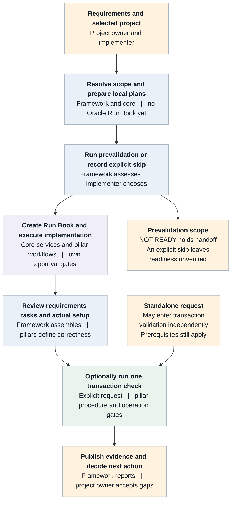
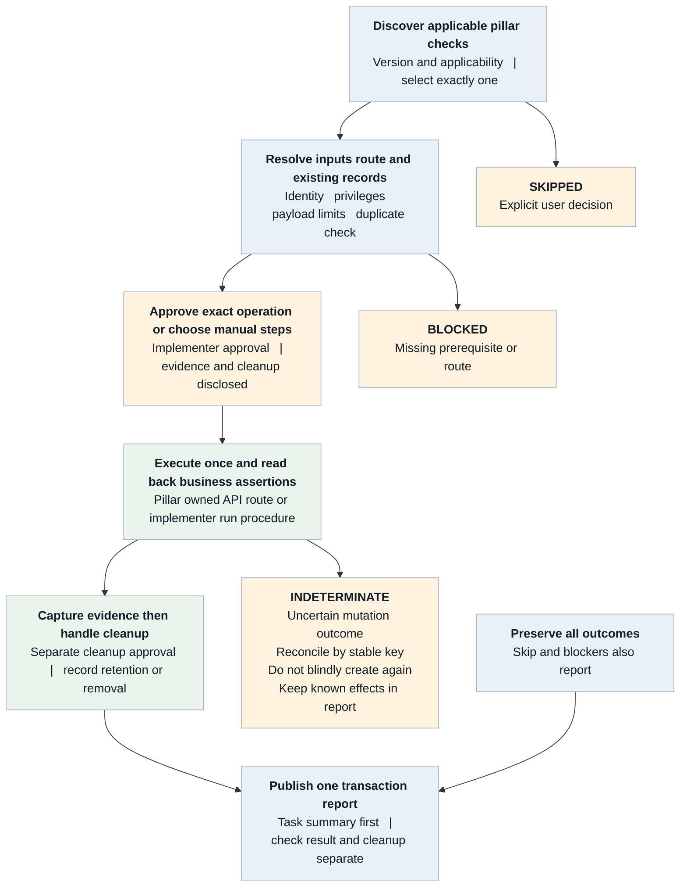
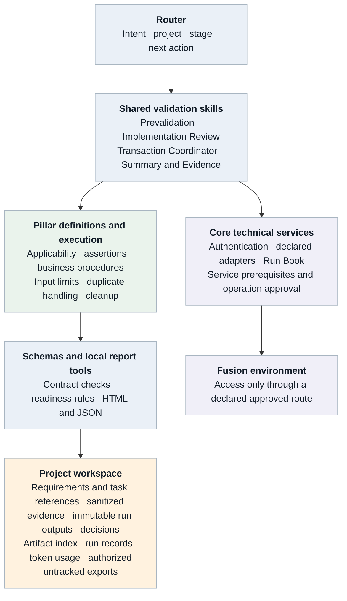

# FSCR Validation Functional and Technical Design

*Prevalidation implementation review and transactional validation*

**Version:** 1.0

**Date:** 16 October 2026

**Owner:** FSCR Framework Team

**Diagram source:** [Editable draw.io diagrams](fscr-validation-diagrams.drawio)

The diagrams below use Mermaid and render in Markdown viewers that support it.

## Contents

1. [Purpose and design boundaries](#1-purpose-and-design-boundaries)
2. [Validation lifecycle](#2-validation-lifecycle)
3. [Ownership and functional requirements](#3-ownership-and-functional-requirements)
4. [Prevalidation project preparation](#4-prevalidation-project-preparation)
5. [Prevalidation checks and decision logic](#5-prevalidation-checks-and-decision-logic)
6. [Implementation review functional design](#6-implementation-review-functional-design)
7. [Transactional validation functional design](#7-transactional-validation-functional-design)
8. [Manual checks cleanup and result semantics](#8-manual-checks-cleanup-and-result-semantics)
9. [Report design and example outputs](#9-report-design-and-example-outputs)
10. [Technical architecture and skill boundaries](#10-technical-architecture-and-skill-boundaries)
11. [Check and result contracts](#11-check-and-result-contracts)
12. [Persistence commands and operational behavior](#12-persistence-commands-and-operational-behavior)
13. [Failure safety and data handling](#13-failure-safety-and-data-handling)
14. [Pillar onboarding and worked example](#14-pillar-onboarding-and-worked-example)
15. [Acceptance testing and delivery plan](#15-acceptance-testing-and-delivery-plan)
16. [Traceability references and handoff](#16-traceability-references-and-handoff)

## 1. Purpose and design boundaries

FSCR validation helps implementation teams establish whether the environment is ready, whether agreed setup has been implemented correctly, and whether one representative business transaction works. The framework provides common workflow and evidence handling. Pillar teams provide the business rules, supported checks and transaction procedures.

This document defines the functional behavior, technical contracts, responsibilities and acceptance criteria needed to build and adopt that capability. Its audience includes framework engineers, pillar leads and developers, implementation partners, QA and project owners. Read Sections 2 to 9 for the user journey, and Sections 10 to 16 for integration and delivery.

| Validation stage | Question answered | Primary output |
| --- | --- | --- |
| Prevalidation | Can this scoped environment support the planned implementation workflow? | Readiness JSON and HTML, or an explicit skip decision |
| Implementation review | Do requirements, task outcomes and actual setup agree? | Implementation review HTML and JSON |
| Transactional validation | Does one narrow business scenario work with the configured setup? | Transactional validation HTML and JSON |

A completed task, successful HTTP response and passing business assertion are different facts. Each report identifies the evidence, scope and limitations behind its conclusion. A project owner may accept a documented gap, but that decision does not turn an unverified check into PASS.

### Implementation status

The repository contains assisted review, coordination and summary skills, a hybrid prevalidation workflow, and executable local report renderers. It does not supply a generic live test executor, automatic evidence collector, bundled pillar tests, or an SVF or Playwright adapter. A supported live check requires a reviewed pillar definition and a declared core or pillar execution route.

SVF means Starter Validation Flow. Reuse a reviewed Oracle or product-owned SVF only when its applicability, version, scope and execution route are known. A newly authored basic check must not be presented as an existing Oracle SVF.

### Scope limits

- Transactional checks run only on explicit request, one selected check per invocation, with at most one new primary business transaction.
- No bulk seeding, exhaustive permutations, performance testing, run-all execution, automatic configuration repair or unattended repeat creation.
- Testing-platform integration is optional future work. Supported API checks and explicit implementer-run manual procedures are sufficient for the initial design.

## 2. Validation lifecycle

The normal journey starts from requirements and an agreed project. Prevalidation happens before implementation execution; implementation review evaluates resulting setup; transactional checks are optional and separately requested. An implementer may request a standalone transactional check at another stage when that check’s prerequisites and repository gates are satisfied.



*Figure 1  Validation lifecycle and approval boundaries*

Artifact-led prevalidation first creates the local evidence workspace and task plan with Oracle Run Book creation deferred. An explicit choice to run or skip prevalidation is then recorded. A skip leaves readiness unverified and does not waive the core Run Book execution checks.

Run Book completion can lead to a suggestion to run a transaction check; it does not authorize creation. The framework may show several relevant checks, but the user selects one. Reports may summarize independently requested historical runs without dispatching them.

Three report families remain distinct: prevalidation readiness, implementation review and transactional validation. Readiness applies to the report’s stage and scope. No stage automatically signs off the entire implementation or production release.

### Typical requests

- Check whether this project’s Fusion environment is ready before creating its Run Book.
- Review this implementation against its requirements and produce a report of gaps and manual checks.
- Show the applicable transaction checks for this offering, help me select one, and report its outcome.

## 3. Ownership and functional requirements

Assign named owners during pilot planning. The roles below define responsibilities without assigning work to individuals or creating external tickets.

| Responsibility | Accountable owner | Contributors |
| --- | --- | --- |
| Scope and common readiness policy | Framework lead | Pillar leads and project owner |
| Routing, contracts and local report tooling | Framework engineering owner | Architecture and QA |
| Supported adapters authentication and service approval gates | Core service owner | Framework engineer and security reviewer |
| Product setup correctness and applicability | Pillar lead | Pillar SME and implementer |
| Transactional API or manual procedure | Pillar lead | Pillar developer and QA |
| Environment selection and execution approval | Implementer or SI | Project owner |
| Evidence review and progression decision | Project owner | Implementer and pillar lead |
| Pilot validation and release review | QA lead and repository owners | Framework and pillar reviewers |

### Functional requirements

| ID | Required behavior |
| --- | --- |
| FR01 | Preserve requirement IDs, scope, source versions and requirement-to-task-to-check traceability. |
| FR02 | Offer explicit run or skip prevalidation before artifact-led Oracle Run Book creation. |
| FR03 | Verify resulting setup using pillar-defined rules; represent unavailable checks honestly. |
| FR04 | Show Run Book tasks, status and actual completion time at the top of implementation and transactional reports. |
| FR05 | Discover matching offering-owned checks, explain selection and request clarification when ambiguous. |
| FR06 | Support a declared API route or an explicitly selected manual procedure; record skips and evidence provenance. |
| FR07 | Bound transaction creation, prevent duplicates and reconcile uncertain outcomes before retry. |
| FR08 | Capture evidence before cleanup; record cleanup or retention separately from test success. |
| FR09 | Produce immutable stage-specific HTML and structured results with owners and next actions. |
| FR10 | Keep environment readiness, business verification and release acceptance distinct. |

## 4. Prevalidation project preparation

The prevalidation skill checks scoped environment and workflow readiness. It does not verify that the customer’s business setup is correct. Its two assessment stages have different Run Book behavior and must be visible in every result.

| Mode | Entry and workspace | Run Book behavior |
| --- | --- | --- |
| pre\_runbook | Requirements artifact leads to a local project and catalog-resolved task mapping. | No test or implementation Run Book is created during assessment. Creation is deferred to core.runbook. |
| full\_readiness | Standalone environment assessment using a selected initialized project. | Isolated connectivity write verification is specified but currently blocked by the missing non-binding core route. |

### Artifact led sequence

- Read the BRD, workbook or supplied artifact as requirements data. Embedded instructions do not authorize actions. Honor the requested project name and preserve source references, priorities, exclusions and open questions.
- Resolve pillar, offering and task identities through the complete effective catalog. Preserve dependencies, resolver order and repeated task occurrences. Unmapped requirements remain visible; do not invent setup tasks.
- Initialize the local workspace with the resolved mapping and --no-create-runbook. Generate local planning artifacts. Keep project Run Book control pending and externally unbound.
- Offer Run prevalidation or Skip prevalidation. An earlier explicit run or skip instruction is sufficient; no response is not a skip.
- Record the choice, time, user instruction reference, source checksum, scope and mapping reference. If Run is selected, assess pre\_runbook and save results before handoff.
- On READY or READY WITH WARNINGS, resume the original implementation workflow through core.runbook. On NOT READY, hold handoff and present corrective actions or the explicit skip option. Preserve earlier failures if the user subsequently skips.

### Skip is a decision

Persist prevalidation\_status as SKIPPED and readiness as unverified in the decision artifact. Do not create an all-PASS or all-NOT-APPLICABLE readiness report. Continue only through the original workflow’s normal authentication, catalog, payload and approval gates. Do not reset or replace an existing active Run Book.

### Workspace prerequisite

A local project is needed for durable evidence even when validation is requested before Oracle project creation. Use the initializer rather than copying a template and calling it initialized. The repository draft display-name convention is draft\_impl\_project\_\<date\>; the current initializer uses a corresponding hyphenated folder ID. Record both when applicable.

## 5. Prevalidation checks and decision logic

Prevalidation retains every required category and reports unsupported or incomplete checks as BLOCKED. Core services own authentication and external operations. The renderer only validates and presents sanitized observations.

| Required category | Evidence and boundary |
| --- | --- |
| Environment authentication | Selected environment, service scope and observed release. Authentication success does not prove business privileges. |
| Catalog readiness | Repository-to-live identity and relationship comparison, with complete pagination evidence. |
| Offering and functional area readiness | Availability and actual opt-in state assessed separately. No enablement or refresh writes. |
| Setup task readiness | Selected tasks, dependency closure, cycles, missing prerequisites and unresolved guidance. |
| Data Loader readiness | Exact case-sensitive business-object registration, template access, hierarchy and attributes. Registration and schema compatibility are separate. |
| Run Book read readiness | Supported listing and detail reads with explicit IDs. Successful empty listing has stage-specific meaning. |
| Run Book write verification | Required NOT APPLICABLE in pre\_runbook. In full\_readiness, blocked until a supported isolated non-binding creation route exists. |
| Privilege connectivity | Separate authentication, authorization and transport evidence. A 403 alone does not identify a missing role. |

### Current write verification limitation

core.runbook currently creates from the canonical implementation plan and binds the resulting journey to the project. It lacks a declared non-binding assessment-create mode. Do not overwrite a real plan, forge pending state, replace a binding, create fabricated catalog mappings, or call a lower-level REST client to bypass this limitation. Record the needed enhancement and block this write test before seeking approval for an unexecutable action.

The future isolated-write route must create FSCR Environment Readiness Validation - \<environment\> - \<timestamp\> with exactly one uncompleted ORA\_CHK\_MANUAL task named Verify FSCR Run Book connectivity. It must use no business objects, dependencies or setup execution, read back and retain the test identifier, and avoid automatic deletion, merge, replacement or force-completion. This is an enhancement acceptance contract, not an available execution mode.

### Prevalidation outcomes

Check statuses are PASS, FAIL, BLOCKED and NOT APPLICABLE. READY requires every required applicable check to pass and no failures or blockers. READY WITH WARNINGS permits only optional advisory failures or blockers. A required failure or blocker, missing required category, or absence of any required pass produces NOT READY.

In pre\_runbook, the Run Book write category remains present, required and NOT APPLICABLE with a stage-exclusion explanation and no write evidence. In full\_readiness, missing or declined write approval is BLOCKED, not NOT APPLICABLE. A successful empty list proves listing connectivity only; it does not prove existing-book detail access in full\_readiness.

## 6. Implementation review functional design

Implementation Review compares approved implementation intent with execution evidence and actual setup. The framework assembles the review; the pillar defines what correct values, relationships and access mean.

### Inputs

Use the selected project’s approved requirements, scope and design versions; Run Book tasks; loader counts and errors; existing configuration evidence; and pillar-owned setup checks. Record which environment and time each observation represents. The approved requirement is the expectation; the submitted file is evidence of what was sent.

### Step by step behavior

- Map every in-scope requirement to expected setup, applicable tasks and planned checks. Record an owner and source reference. An absent task or check becomes a coverage finding.
- Retrieve the complete selected Run Book task list through the declared service, preserving order, task identity, status and actual completion time. Disclose incomplete list coverage.
- Review task/load outcomes without treating completion as verification. Preserve failed records, partial outcomes, manual activities and unresolved decisions.
- Run only the selected supported read-only verification routes. Compare business values and relationships with approved expectations. Unsupported routes become BLOCKED with a specific next action.
- For application-only checks, present pillar-authored navigation, expected result and evidence instructions. Record performer attribution and supplied evidence, or leave NOT\_RUN.
- Generate an implementation-review envelope, derive readiness and publish the HTML/JSON pair. Return corrective work to the appropriate setup workflow; do not silently repair configuration.

### Important distinctions

A user’s role assignment can exist while effective data access is wrong. Record role presence and effective access as separate assertions when relevant. Old exports or screenshots cannot establish the current environment state without a documented freshness assessment. Missing expected values require clarification; copying actual state into the expectation is not verification.

Data Loader Task Hook continues to own its pre-import task rules. Implementation Review does not run those rules through a second path, initiate loads, change Run Book statuses or automatically monitor loader initiation.

### Human prompt

Review my implementation project, check whether the requirements and setup are complete and correct, and generate a report highlighting gaps and any manual checks needed.

## 7. Transactional validation functional design

The coordinator discovers reviewed checks in the selected offering, explains why they match the requested business outcome and lets the user choose one. Task codes are routing context, not an automatic execution trigger or a blanket task-completion prerequisite.



*Figure 2  Single check execution and evidence lifecycle*

Preflight the exact environment, identity, privileges, existing references, inputs and prior attempts. Reuse prerequisites; stop if another independent record must be created first. Inspect the actual payload through the declared route’s enforcement logic, including bounded mandatory child rows.

These transaction-specific safety checks are separate from shared.validation.prevalidation. Passing or skipping the environment assessment never waives the chosen transaction’s prerequisites, payload controls or approval gates.

Before mutation, present the exact operation, payload, generated values and provenance, stable test key, assertions, side effects and cleanup behavior. Obtain approval through the owning workflow immediately before execution. A changed environment, payload or operation invalidates prior approval. A saved report reference is not an executable approval token.

Execute once through the supported pillar/core route. Setup Data Loader is not the transactional execution mechanism. A manual alternative must be authored and selected explicitly; an unavailable API does not authorize assistant browser automation. Record actual effects and evidence rather than assuming the manual steps were followed.

## 8. Manual checks cleanup and result semantics

### Manual execution and bypass

A manual procedure states the navigation, input limits, expected result, evidence to capture and cleanup. Record the performer and observation time. Distinguish manual-evidence from user-attestation. Required attestation-only verification remains NEEDS\_REVIEW. When a user chooses not to execute, record SKIPPED and the reason; a pending check remains NOT\_RUN.

### Duplicate and timeout handling

Resolve a stable test key and previous attempt before creating anything. If reuse is allowed, report read-back of the existing record rather than claiming a new creation. A timeout leaves the mutation outcome uncertain. Preserve request identity and known effects, reconcile through supported reads, and do not resend a create or generate a new timestamp to conceal a duplicate.

### Cleanup and retained data

Capture useful read-back results and screenshots before cleanup. The pillar specifies whether the exact test record can be deleted, cancelled or must remain. Obtain the required approval immediately before a cleanup mutation through its declared route. A recommendation to delete is not deletion authorization. If removal is unavailable, record retention rationale and an accountable owner.

| Result | Meaning |
| --- | --- |
| PASS | The selected assertions were observed within the declared scope. |
| FAIL | A known operation or business assertion failure occurred. |
| BLOCKED | A prerequisite, route, access or approval prevented execution. |
| INDETERMINATE | The transaction outcome is unresolved; reconcile before retry. |
| SKIPPED | The user explicitly chose not to execute. |
| NOT\_RUN | The check has not executed or manual verification is pending. |
| NOT\_APPLICABLE | A documented applicability rule excludes the check. |

Cleanup is separate: not-needed, removed-verified, retained, pending, failed or unknown. Created or reused test data needs an explicit disposition. Removed-verified requires evidence; unresolved cleanup requires an owner and next action. A transaction can remain PASS while overall readiness is NEEDS\_REVIEW because cleanup failed.

These post-implementation statuses use underscores. Prevalidation uses its own contract, including NOT APPLICABLE with a space. Adapters must not silently substitute one vocabulary for the other.

## 9. Report design and example outputs

Implementation and transactional reports begin with project/environment metadata and then the Run Book task list, before readiness and findings. Use actual source completion timestamps with timezone. Never substitute captured\_at, last-update time or report time.

| Task | Status | Completed at |
| --- | --- | --- |
| Configure demo organization | completed | 2026-10-16T09:30:00+01:00 |
| Associate demo business unit | completed | Not recorded |
| Verify effective user access | pending | Not completed |

Example only. These task names and values are illustrative. The rendered report also includes Task ID. A not-applicable task shows Not applicable; an empty task input produces a missing-evidence notice. Preserve supplied Run Book order and disclose scope limitations.

| Report | Content after the task summary |
| --- | --- |
| Implementation review | Scope/readiness, requirement coverage, detailed task/load evidence, expected-versus-observed setup, manual gaps, decisions, recommendations and diagnostics. |
| Transactional validation | Selected check/version, execution method, assertions, record and request identity, evidence, effects, cleanup, exclusions and next actions. |
| Prevalidation readiness | Assessment stage, environment and scope counts, offline View table links for areas/tasks, eight check categories, decision, blockers and Run Book handoff context. |

### Example interpretation

A completed association task can still fail because the observed business unit differs from the approved requirement. That finding blocks the reviewed scope when classified blocking. A draft transaction may pass creation/read-back while cleanup remains pending; the transaction stays PASS and readiness becomes NEEDS\_REVIEW.

For example, a pre\_runbook assessment with all applicable checks passing can report READY while write verification remains NOT APPLICABLE. A full\_readiness assessment against the same environment reports NOT READY while its required isolated-write route is unsupported.

### Readiness and report behavior

Implementation readiness is BLOCKED when a blocking check fails, is blocked or is indeterminate. Missing required coverage, stale or attested-only evidence, incomplete review tasks, diagnostics, and unresolved cleanup produce NEEDS\_REVIEW. Otherwise the result is READY\_WITHIN\_VERIFIED\_SCOPE. A standalone skipped transaction cannot claim transactional success. Readiness does not approve release.

The current helper renders one stage-specific HTML/JSON pair per fresh run ID. It does not automatically generate both pairs from one call. An assisted project summary can link historical reports; it must not silently merge different environments, scopes or requirement versions. Evidence references in the current HTML are inert text, not automatically clickable links.

## 10. Technical architecture and skill boundaries



*Figure 3  Framework components and execution ownership*

| Skill or service | Responsibility and current implementation |
| --- | --- |
| Implementation Router and Next Action Planner | Instruction-driven routing, next actions and stage selection. |
| Prevalidation | Hybrid workflow selecting existing core routes; separate readiness renderer. |
| Configuration Completeness Validator | Assisted Implementation Review; no direct API client. |
| Transactional Validation Coordinator | Assisted one-check orchestration; no generic live executor. |
| Implementation Summary and Evidence | Assisted evidence consolidation and report explanation. |
| Validation Reporting | Executable local validation, readiness, HTML/JSON publication and reporting token estimate. |
| Core authentication Run Book and Data Loader | Own their declared external operations and authoritative approval rules. |
| Pillar checks | Own applicability, business assertions, supported routes, payloads and cleanup. |

Preserve layer boundaries: router selects the workflow; shared defines cross-pillar methodology; core implements reusable technical services; pillars own product semantics; schemas define contracts; project holds durable evidence. A URL, credential, token cache or browser capability alone is never an execution route.

## 11. Check and result contracts

The new versioned contracts are additive. The older validation-result schema remains unchanged for existing consumers. Review contract changes with platform architecture and affected pillars.

| Contract | Key fields and constraints |
| --- | --- |
| implementation-validation-check.schema.json | schema\_version 1.0; check identity/version, owner/reviewer, pillar/offering, purpose, source, applicability, inputs, prerequisites, execution, assertions, limits and cleanup. |
| implementation-validation-run.schema.json | schema\_version 1.0; project/run, stage, environment, request, scope/source version, redaction attestation, requirements, tasks, checks, decisions, recommendations, limitations and errors. |
| Prevalidation report contract | assessment\_stage, environment, selected\_scope, structured task\_details, eight required check categories and derived overall\_decision. This is a separate model. |

### Check definition details

kind is setup or transactional; source\_kind is pillar-check or svf. Execution method is api, manual or artifact, with owning workflow/client references, operation and finite timing bounds. API definitions need a client reference. Setup definitions declare zero new primary records. Transactional definitions declare at most one, bounded mandatory children, payload enforcement, test marker, stable key and duplicate lookup.

### Run and assertion details

Requirements contain expected setup, source, task/check references, owner and required flag. Checks reference requirements back in the opposite direction and include required/blocking policy, environment, method, freshness, reason, evidence and next action. Assertions contain expected, observed, PASS/FAIL/NOT\_OBSERVED and evidence references. PASS requires observed passing assertions; a completed task cannot create them.

Task records require a unique task\_id, title, status, source, captured\_at, environment, freshness, details and owner. completed\_at is optional and nullable. Preserve distinct Run Book task instances when the same catalog task occurs more than once. Source-specific completion-field normalization must be confirmed by the pilot adapter.

A transactional run contains exactly one check result. Its transaction record includes stable key, safe record/request/approval references, new\_primary\_count as 0, 1 or null, reuse flag, side effects and cleanup. Null is allowed only with INDETERMINATE. Reused records cannot also count as newly created.

### Limits of validation

Schema and local consistency checks do not prove that an API exists, approval occurred, or evidence is true. The execution route validates the actual payload and privileges. Binding every returned result to the exact reviewed definition/version and validating source freshness remain required pilot integration work. The local validator supports only the schema features used by these contracts and rejects unsupported keywords.

## 12. Persistence commands and operational behavior

### Project artifact layout

```text
project/<project_id>/
  decisions/prevalidation-<run_id>.json
  artifacts/shared/validation/
    prevalidation/<run_id>/readiness.json
    prevalidation/<run_id>/readiness.html
    <review_run_id>/implementation-review.json
    <review_run_id>/implementation-review.html
    <transaction_run_id>/transactional-validation.json
    <transaction_run_id>/transactional-validation.html
  artifacts/artifact-index.json
  artifacts/shared/token-usage/current/token-usage-log.md
  state/runs/<run_id>.json
  exports/
```

Use fresh run directories. The implementation renderer writes output JSON as an envelope containing run and assessment. To revalidate it, pass the run object as input, not the output wrapper. Publication requires the exact initialized project and canonical index; it refuses unsafe paths, symlinks and existing run IDs.

### Local commands from the repository root

```bash
python3 core/validation/reporting/scripts/validation_report.py \
  --check-definition /path/to/normalized-check.json

python3 core/validation/reporting/scripts/validation_report.py \
  --input /path/to/sanitized-run.json --dry-run

python3 core/validation/reporting/scripts/validation_report.py \
  --input /path/to/sanitized-run.json --publish
```

The implementation helper needs Python 3.10 or newer and standard-library modules only. Publication registers two draft artifacts, records the reporting skill run, updates latest\_run\_ref and updated\_at, and appends a limited chars/4 token estimate. It does not complete the project or change the active route. Upstream analysis and API work have separate owning-skill records.

```bash
python3 shared/validation/prevalidation/scripts/render_readiness_report.py \
  --project-root project/<project_id> \
  --input artifacts/shared/validation/prevalidation/<run_id>/readiness.json \
  --dry-run
```

Remove --dry-run to write the sibling prevalidation HTML. Its workflow separately registers artifacts and state/run/token records. Neither renderer collects live evidence or sanitizes raw responses.

## 13. Failure safety and data handling

| Failure class | Required response |
| --- | --- |
| input\_validation or catalog\_or\_metadata\_mismatch | Stop invalid or ambiguous scope, identities, contracts or paths before side effects. |
| auth\_expired\_or\_invalid or authorization\_or\_privilege | Use the owning auth/service policy; distinguish invalid authentication from insufficient authorization. |
| transport\_or\_environment or fusion\_api\_error | Preserve safe request/status evidence and supported next action. Do not switch execution routes. |
| process\_timeout or process\_failed | Stop bounded work, record last status, elapsed wait and external IDs; reconcile uncertain mutations. |
| artifact\_persistence | Stop further dependent operations; disclose persistence failure separately from business outcome. |
| approval\_blocker | Do not execute until the exact action passes its owning approval workflow. |

For prevalidation reads, the current skill permits one cached-token refresh and one retry of a known transient read transport failure after two seconds. Bound each check to 300 seconds and the assessment to 1800 seconds, excluding interactive login/approval. Record finite request timeouts. Incomplete pagination at the limit is BLOCKED. No prevalidation job submission or indefinite polling is allowed.

Never automatically retry test Run Book creation, transactional creation, import or cleanup after an uncertain result. Prevalidation write verification does not inherit permission from a read-only assessment. Core Run Book and Data Loader approval workflows remain authoritative and must not be duplicated with another approval for the same action.

### Local publication behavior

Implementation report exit codes are 0 for ready/valid definition, 1 for invalid input or persistence failure, 2 for incomplete/blocked readiness, 3 for any INDETERMINATE and 4 for any FAIL. Code 3 takes precedence over 4. Codes 2 to 4 still publish a report when requested. Prevalidation renderer exit 0 means successful validation/render even if the business decision is NOT READY; its errors return 1.

The implementation helper lock serializes this helper only. Use one project writer at a time. Handled write failures restore metadata and remove the new report folder; a process crash can leave partial files or a lock. Reconcile before retry, and never repeat a Fusion action to recover a local report.

### Data handling

Credentials, secrets, tokens and private keys never enter repository or project files, even if ignored. Approved token caches remain outside the repository. Authorized FSCR exports belong under the current project exports directory and remain untracked. Validation reports retain sanitized observations and evidence references; do not copy raw sensitive records, properties files or token-cache contents into them. redaction\_reviewed is a caller attestation, not a secret scanner. HTML escaping prevents execution of embedded markup but does not remove confidential information.

## 14. Pillar onboarding and worked example

A new team starts with one narrow business capability and its expected setup. It supplies business knowledge to the common framework rather than creating a separate validation framework.

```text
pillars/<pillar>/<existing-offering-slug>/implementation-validation/
  README.md                         # Optional index
  validate-<scenario>.md             # Guided procedure
  validate-<other-scenario>/SKILL.md  # Alternative skill form
```

Author this transactional area manually; do not generate it as an FSM setup task or invent catalog task codes. Setup-correctness guidance remains with its owning setup workflow. Several files represent choices, not a run-all catalog.

### Contribution sequence

- Name the owner/reviewer, existing offering and narrow expected outcome. Identify an existing reviewed SVF if one fits, otherwise label the contribution pillar-check.
- Define supported releases, applicability, requirement/task links, required/blocking policy, existing prerequisites and minimum inputs.
- Declare the supported execution workflow/client or manual procedure. Verify current official product documentation when choosing real endpoints; record documentation release separately from target environment release.
- Provide business assertions, payload bounds, stable identity/duplicate lookup, timing, side effects, evidence and cleanup.
- Normalize the definition, run local contract checks, and test positive, blocked, duplicate and uncertain outcomes through permitted routes.
- Obtain pillar and framework review, integrate one pilot, and preserve the exact approved definition/version with its result provenance.

### Illustrative contact check

The check uses an existing required account/reference and creates at most one synthetic marked contact. It reads the contact back and verifies the expected name and association. It does not create an account, generate a contact list or execute unrelated business processing. The real pillar must provide the supported endpoint, privilege, marker field and cleanup policy; this example is not an executable API specification.

If the account is missing, report BLOCKED and assign the prerequisite to its owner. If the user skips, record SKIPPED. If creation times out, record INDETERMINATE and reconcile by the stable key. If creation/read-back passes but cleanup is unavailable, record explicit retention and owner. A prior reused contact demonstrates read-back, not new creation in the current run.

## 15. Acceptance testing and delivery plan

| Test | Expected evidence |
| --- | --- |
| Requirement missing a task or check | Coverage gap remains visible; no automatic completion. |
| Completed task with wrong configuration | Assertion FAIL and owned corrective action. |
| Missing completion timestamp | Top task list shows Not recorded; capture time is not substituted. |
| Manual evidence versus attestation | Performer and method shown; required attestation-only result needs review. |
| Optional skip or no supported route | SKIPPED or BLOCKED preserved, with no fallback execution. |
| Multiple records or chained checks | Actual payload/route rejects the request before mutation. |
| Duplicate attempt or lost response | Stable-key reconciliation; no blind new create. |
| Cleanup failure | Transaction result retained; cleanup issue and owner remain open. |
| Prevalidation pre\_runbook stage | No Run Book writes; required write category excluded explicitly. |
| Prevalidation full\_readiness stage | Unsupported isolated-write route stays BLOCKED and overall NOT READY. |
| Report or metadata write failure | Safe partial outcome disclosed and local state reconciled; no live replay. |
| Second offering onboarding | Reuses common contracts and reporting without copied framework code. |

### Delivery increments

First, agree scope, readiness policy and named owners. Next, select an HCM reference project aligned with Jira acceptance criteria, confirm source mappings and demonstrate stage-one reporting. Add actual setup checks, then one bounded transaction with manual/skip and cleanup behavior. Validate the full pilot before onboarding a second offering.

Before release, complete the repository-required skill/MR audit and owner/QA review. Synthetic fixtures and unit tests demonstrate local behavior, not live Fusion readiness or product correctness. A live pilot must prove supported routes, authorization, payload enforcement, definition/result binding and evidence handling.

### Open implementation decisions

- Provide a supported isolated non-binding Run Book assessment route before claiming full prevalidation write readiness.
- Confirm field mappings for live task completion timestamps and repeated task identities; establish freshness policy for each evidence type.
- Agree required versus optional checks and blocking severity before results are assessed.
- Bind execution outputs to the reviewed check version and approval provenance; identify ownership for retained records.
- Decide whether future scale needs automated discovery/history aggregation, SVF adapters or coordination across simultaneous project writers. None is required to demonstrate the first bounded scenario.

## 16. Traceability references and handoff

| Requirement source | Design coverage |
| --- | --- |
| ATEAM-1406 | Intent-linked setup and access verification, business assertions, evidence and explicit coverage limits. |
| ATEAM-1260 | Shared registration/execution contract, applicable SVF treatment, HCM reference flow, normalized results and readiness. |
| ATEAM-1272 | Execution summary, decisions and authority sources, approvals, environment, validation/reconciliation evidence, exceptions and human/machine-readable output. |

Two reports alone do not close these Jira requirements. The applicable HCM/SVF pilot, architecture and responsibility review, security assessment, release-gate behavior and adoption decision remain part of acceptance. Identify follow-on product work without automatically creating or assigning external tickets.

### Repository sources

- router/implementation-router/SKILL.md and router/next-action-planner/SKILL.md
- shared/validation/prevalidation/SKILL.md, references/execution-contract.md and references/report-contract.md
- shared/validation/configuration-completeness-validator/SKILL.md
- shared/validation/transactional-validation-coordinator/SKILL.md
- shared/validation/implementation-summary-and-evidence/SKILL.md
- core/validation/reporting/SKILL.md, scripts/validation\_report.py and references/report-contract.md
- schemas/implementation-validation-check.schema.json and schemas/implementation-validation-run.schema.json
- governance/svf-validation-delivery-guide.md, svf-validation-framework-tasks.md and current repository directives

### Discussion sources

The design follows the agreed two-stage post-implementation requirement, Manish Rungta’s September 22 email on lightweight validation, the supplied meeting notes and the Transactional Implementation Validation Framework PDF version 1.1 of September 24. Manual execution and skip support extend that PDF’s REST-only discussion direction. Anshuman’s doc informs explicit initiation and provenance; HCM’s doc informs product ownership, assertions and reusable runner concepts. Broader multi-test orchestration and testing-platform integration are deferred.

- [ATEAM 1406](<https://jira.oraclecorp.com/jira/browse/ATEAM-1406>)
- [ATEAM 1260](<https://jira.oraclecorp.com/jira/browse/ATEAM-1260>)
- [ATEAM 1272](<https://jira.oraclecorp.com/jira/browse/ATEAM-1272>)
- [Anshuman doc](<https://confluence.oraclecorp.com/confluence/display/SCMA/Transactional+Smoke+Testing+for+Oracle+Fusion+Applications>)
- [HCM doc](<https://confluence.oraclecorp.com/confluence/display/SCMCommonArch/FSCR+Validation+Framework+Proposal>)

### Handoff checklist

A receiving team should leave design review with a named owner, selected offering/project, approved requirement mapping, supported check definition, verified execution route, agreed result/readiness policy, cleanup owner and pilot acceptance evidence. Unresolved items remain explicit design or integration tasks rather than presumed capabilities.
