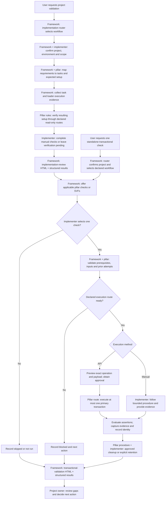

# FSCR SVF and Implementation Validation: Delivery Guide

**Audience:** FSCR framework team, pillar leads, developers, QA, and implementation partners

**Document owner:** FSCR framework team

**Version:** 0.1 — proposed delivery approach for review

**Date:** 9 October 2026

> This guide describes the proposed implementation workflow and delivery responsibilities. It does not authorize a Fusion operation, declare a new skill operational, or replace existing execution and approval controls. Named individual delivery owners and dates remain to be assigned.

## 1. Outcome and scope

Provide a simple, project-specific answer to two questions:

1. **Implementation review:** Were the agreed requirements implemented, and does the resulting setup match the expected configuration?
2. **Transactional validation:** Can the configured capability support one representative business transaction?

Produce two HTML reports, backed by structured results, with explicit gaps, evidence, owners, and next actions. Use existing services and pillar knowledge. Integration with a testing platform is not a prerequisite.

| Stage | Included | Boundary |
| --- | --- | --- |
| Implementation review | Requirement coverage, task and load outcomes, setup-value checks, relevant security checks, manual verification, readiness | Task completion or loader success alone does not prove correct configuration. |
| Transactional validation | One selected, bounded business check; supported API or explicitly authored manual procedure; assertions and cleanup | No bulk creation, run-all action, performance testing, exhaustive permutations, or automatic repair. |
| Reporting | Evidence, decisions, approvals, exclusions, unresolved items, and corrective ownership | Report only what was observed; do not turn skipped or unverified scope into a pass. |

**SVF means Starter Validation Flow.** Reuse an applicable, product-reviewed SVF when its execution method and scope are supported. A basic pillar check may meet the same narrow business need without a testing-platform integration. Do not describe an arbitrary new check as an existing Oracle SVF. The pillar identifies the source, version, applicability, and coverage of any reused flow.

## 2. Ownership

Framework owns the common process and evidence model. Pillars own business correctness. Implementers own project choices and execution approval.

| Role | Responsibilities |
| --- | --- |
| Framework delivery lead | Scope, architecture, common contracts, delivery sequencing, coordination, and readiness policy. |
| Framework developers | Routing, discovery, integration with existing services, shared controls, result aggregation, HTML rendering, and project persistence. |
| Pillar lead / reviewer | Approve scenarios, setup rules, supported execution methods, applicability, scope limits, and customer-ready content. |
| Pillar developer / SME | Author setup checks and transactional procedures, assertions, supported APIs, manual instructions, test identity, and cleanup. |
| Implementer / SI | Confirm project and environment, resolve input ambiguity, select or skip checks, approve mutations, perform manual checks, and review residual data. |
| Business / project owner | Confirm intended outcomes, approved scope, and acceptance of outstanding gaps; own the decision to progress. |
| FSCR QA | Verify common controls, pilot behavior, evidence accuracy, failure handling, and cross-pillar reuse. |

Acceptance of a gap is a recorded decision; it does not change the underlying validation result.

## 3. End-to-end flow

The normal project journey reviews implementation first. A standalone transactional request may enter stage two directly; all check-specific prerequisites and repository workflow gates still apply.



No approval means no automated mutation. A declined execution is recorded as skipped; missing required approval that prevents execution is blocked. A timeout or uncertain outcome enters reconciliation before any new create attempt.

## 4. Runtime steps

| Step | Action | Responsible owner | Output / completion condition |
| --- | --- | --- | --- |
| 1 | Confirm the implementation project, target environment, requested scope, and approved requirement/design versions. | Framework + implementer | Unambiguous project binding; missing inputs identified. |
| 2 | Map each in-scope requirement to expected setup, relevant tasks, and a verification method. Include relevant users, roles, mappings, and data scope. | Framework assembles; pillar validates semantics | Traceability table; unmapped requirements become findings. |
| 3 | Collect task status, partial completion, loader counts/errors, manual activities, and open decisions through declared services. | Framework | Timestamped execution evidence; stale or unavailable evidence marked. |
| 4 | Compare actual setup with expected values and relationships using pillar-defined checks. Use a supported read-only API or an explicitly routed suitable export. | Pillar defines checks; framework coordinates | Expected-versus-observed assertions with source and environment. |
| 5 | Provide application navigation, expected result, and evidence instructions where automated verification is unavailable. | Pillar writes procedure; implementer performs it | Manual evidence or an unresolved verification gap. |
| 6 | Generate the implementation-review report with coverage, findings, readiness, owners, and next actions. | Framework | HTML report and structured results agree. |
| 7 | Present relevant transactional checks/SVFs. Let the user select one or skip. | Framework + implementer | Exact scenario/version selected; selection rationale or skip recorded. |
| 8 | Confirm required references, identity, privileges, supported route, minimal inputs, record limits, side effects, and previous attempts. | Framework controls + pillar procedure | Ready preview or an actionable blocked result. |
| 9 | Execute the selected API check after explicit approval, or guide the authored manual check. | Implementer approves/performs; pillar route executes | At most one new primary transaction; known or indeterminate outcome recorded. |
| 10 | Read back or inspect the result, evaluate assertions, and capture safe evidence before cleanup. | Pillar assertions + implementer for manual checks | PASS/FAIL or unresolved result; clear evidence provenance. |
| 11 | Apply the declared cleanup policy through the approved route, or record retention/manual follow-up. | Pillar defines; implementer approves/performs | Cleanup outcome and residual record responsibility recorded separately. |
| 12 | Generate the transactional report, register artifacts, append the run record, and record token usage. | Framework | Durable project history with links to both reports and open actions. |

### Stage-one comparison rules

- The approved requirement and design decision define the expected state. Source files show what was submitted; they are not automatically authoritative expectations.
- Missing or ambiguous expected values require clarification; do not infer them from the current environment and then declare a match.
- Verify business relationships as well as existence where relevant. A record may exist in the wrong organizational scope.
- Distinguish role assignment presence from effective access. Use a supported access check or a specific manual verification for the latter.
- Include source environment, record identity, capture time, and limitations. Old local evidence does not prove the current environment state.
- Preserve pre-import validation ownership. Do not bypass Data Loader Task Hook by executing its rules from a new shared workflow.
- Return corrective work to the responsible setup skill or owner; validation does not silently modify configuration.

## 5. Minimum pillar contribution

Pillars contribute two kinds of knowledge: setup-correctness checks for stage one, and bounded transactional checks for stage two. Reuse existing setup guidance through its owning workflow. Keep transactional checks in the offering-level area described below.

```text
pillars/<pillar>/<existing-offering-slug>/implementation-validation/
  README.md                         # Optional index and ownership
  validate-<scenario>.md            # Guided check
  validate-<other-scenario>/
    SKILL.md                        # Alternative executable/guided skill form
```

These are alternative forms; every check does not need both. Author this transactional area manually. Do not generate it as an FSM setup task with Pillar Skill Gen or invent setup-task codes/catalog flags. Multiple checks are choices, not a batch workflow.

### Required check contract

| Field | Pillar must provide |
| --- | --- |
| Identity and ownership | Stable check ID, title, version, offering, owner, reviewer, and review triggers. |
| Purpose and applicability | Narrow outcome, linked requirements/setup, supported releases, source SVF identity if applicable, and explicit exclusions. |
| Prerequisites | Existing setup/reference records, environment, user identity, privileges, and necessary access scope. |
| Inputs | Minimum required fields, safe synthetic values, validation constraints, and source of each value. |
| Execution | Supported API/client/operation or precise manual procedure; references to current authoritative product guidance. |
| Record controls | One-primary-transaction limit, bounded mandatory children, supported marker, stable correlation key, duplicate lookup, and reuse policy. |
| Assertions | Expected values, read-back checks, what constitutes failure, and what success actually proves. |
| Evidence | Safe record/request IDs, observed assertions, screenshot or response evidence, and manual performer where applicable. |
| Failure behavior | Missing-input, unsupported-route, timeout, partial-effect, and uncertain-outcome handling. |
| Cleanup | Whether delete/cancel is supported, exact target identification, approval scope, evidence-before-cleanup, and retention owner when removal is unavailable. |

For `SKILL.md`, also declare repository-compliant inputs, outputs, dependencies, execution mode, applicability, privileges, side effects, workspace persistence, and token usage.

### Transaction limits

1. One selected check per explicit invocation; at most one new primary business transaction.
2. Reuse prerequisites. If an additional independent record must be created first, stop and report the prerequisite.
3. Bound intrinsic child rows to the minimum supported number. Inspect the actual payload, not just a caller-supplied count.
4. Reject bulk inputs, loops, parallel creation, chained checks, run-all, unattended repeats, and repeat-until-pass behavior.
5. Resolve prior attempts using a stable test key. Reusing an existing record proves read-back only, not new creation in this run.
6. Do not automatically retry a mutation. Reconcile timeout/unknown outcomes before considering another attempt.
7. Declare notifications, workflows, posting, and other downstream effects. Stop at the minimum lifecycle state needed.
8. Apply equivalent scope limits to manual procedures. Report deviations and actual effects rather than assuming compliance.

### Manual and unsupported paths

The user's agreed direction includes guided manual checks and the option to skip. This extends the September 24 PDF's REST-only discussion direction and requires a documented revision before release.

A missing API is not permission to substitute a browser, loader, or another adapter. Record the automated path as blocked. A manual alternative may be offered only when the pillar has authored it and the workflow explicitly selects it. The user performs the application steps; assistant-driven browser execution needs its own declared route.

## 6. Result and readiness rules

Keep execution status, verification method, readiness, and cleanup as separate fields.

| Result | Meaning |
| --- | --- |
| PASS | The stated assertions were observed, within the stated scope. |
| FAIL | A known transaction or assertion failure occurred. |
| BLOCKED | A necessary prerequisite, supported route, privilege, or approval is missing. |
| INDETERMINATE | The operation outcome is unknown and requires reconciliation. |
| SKIPPED | The user explicitly chose not to perform the check; record the reason. |
| NOT RUN | The check has not been executed or manual verification is pending. |
| NOT APPLICABLE | The pillar applicability rule excludes this check from the confirmed scope; record the reason. |

Record verification method as automated API, manual with evidence, user attestation, or local-artifact review. User attestation must not be presented as independently observed verification.

**Proposed readiness policy, to approve during design:**

- **Ready within verified scope:** required checks passed, with no unresolved required coverage gaps or blocking findings.
- **Needs review:** required verification is incomplete, skipped, stale, or based on evidence needing review.
- **Blocked:** a declared blocking finding or unresolved critical operation prevents the intended next stage.

Optional skipped smoke tests do not automatically block progression. Required/optional classification and severity come from the approved project/pillar policy, not the renderer. Bypassing a suggested check cannot bypass an execution-safety prerequisite. A project-owner acceptance records the decision and rationale without rewriting results.

Cleanup values should distinguish not needed, removed and verified, retained intentionally, pending manual action, failed, and unknown. A passing transaction with failed cleanup retains its transaction result and an open cleanup finding.

## 7. Reports and durable evidence

Generate HTML from a common structured result model. The same renderer can produce both report views. Do not maintain separate hand-edited truths.

| Implementation review report | Transactional validation report |
| --- | --- |
| Project/environment and scope version | Project/environment and scenario versions |
| Requirement-to-task/check coverage | Requested, selected, skipped, and executed checks |
| Task completion and loader outcomes | Execution method and approval reference |
| Expected versus observed setup | Expected versus observed business assertions |
| Security/access verification boundaries | Created/reused record and new-record count |
| Failed, pending, and manual checks | Evidence, partial effects, and unknown outcomes |
| Decisions, authority sources, exceptions | Cleanup, retained records, and follow-up owners |
| Readiness, gaps, owners, next actions | Coverage limitations and recommended next action |

Suggested output layout, to finalize in the artifact contract:

```text
project/<project-id>/artifacts/shared/validation/<run-id>/
  implementation-review.html
  implementation-review.json
  transactional-validation.html
  transactional-validation.json
  evidence/                         # Sanitized evidence only

project/<project-id>/state/runs/<run-id>.json
project/<project-id>/artifacts/shared/token-usage/current/token-usage-log.md
```

Only create the report(s) applicable to that run. A project summary may aggregate separately requested runs; it must never dispatch those runs. Preserve historical results and supersession links when checks are repeated. Show the timestamp and environment of each result.

Persist safe identifiers, redacted observations, and approved evidence references. Never persist credentials, tokens, raw customer records, or sensitive screenshots in tracked files or project workspaces. Capture screenshots only where useful and permitted; API read-back evidence can be sufficient. Follow current repository data-handling rules even where older proposals suggest storing recovered source files locally.

## 8. Skills and repository work

The following is a proposed architecture, not a list of newly implemented capabilities.

| Capability | Proposed action | Delivery owner |
| --- | --- | --- |
| `router.implementation-router` | Extend routing to the two validation intents; retain existing project and execution gates. | Framework |
| `shared.validation.configuration-completeness-validator` | Strengthen the existing assisted skill into the Implementation Review methodology; coordinate requirement coverage and pillar checks. | Framework + pillar reviewers |
| `shared.validation.transactional-validation-coordinator` | Add the shared selection, single-check coordination, manual/skip, and result-collection workflow. Delegate technical execution to declared core/pillar routes. | Framework |
| `shared.validation.implementation-summary-and-evidence` | Add project-wide evidence consolidation and the two report views. | Framework |
| Core helpers | Add only missing result normalization, report rendering, and common control primitives. Reuse existing services and keep business assertions out of core. | Framework |
| Schemas | Define check/result/traceability contracts; extend or version the existing validation schema without breaking consumers. | Framework architecture + pillar review |
| Offering-owned checks | Manually author reusable setup verification contributions and bounded transactional checks in their appropriate locations. | Pillars |
| Project integration | Register reports and evidence, append durable run records, and log token estimates. | Framework |

### Reuse assessment from the October 9 checkout

- [Run Book](../core/runbook/SKILL.md) provides task/status/detail tooling through its declared routes.
- [Data Loader](../core/data-loader/SKILL.md) provides supported load-status and error reporting. Its own approval and persistence rules remain authoritative; do not turn validation into a second loader execution path.
- [Setup Data Validator](../shared/validation/setup-data-validator/SKILL.md) supports artifact/import-readiness review, not complete post-implementation verification.
- [Configuration Completeness Validator](../shared/validation/configuration-completeness-validator/SKILL.md) currently contains generic assisted guidance.
- [Project State Manager](../core/project-mgmt/project-state-manager/SKILL.md) and [Artifact Registry Manager](../core/project-mgmt/artifact-registry-manager/SKILL.md) define persistence and registration responsibilities.
- [Validation Result schema](../schemas/validation-result.schema.json) currently represents passed/warning/failed findings; it needs a richer, compatible contract for this design.
- The Playwright runner and centralized transactional workflow described in the proposals were not found in this checkout. Confirm any implementation elsewhere before planning reuse. Neither is an initial-release dependency.

All external reads and writes must be selected by the active workflow and use its declared client after required checks. The existence of a REST reference or credentials is not an execution route. Unsupported paths remain blocked with a next action.

## 9. Step-by-step delivery plan

| Order | Work package | Accountable role | Contributors | Exit evidence |
| --- | --- | --- | --- | --- |
| 1 | Agree two-stage scope, exclusions, SVF reuse policy, manual/skip extension, and readiness rules. | Framework lead | Pillar leads, project owner | Reviewed decision record; unresolved choices listed. |
| 2 | Select one pilot project and HCM reference scenario aligned with Jira acceptance criteria. | Framework lead + HCM lead | Implementer, QA | Named owner, project/environment, expected outcome, available evidence. |
| 3 | Build requirement-to-task-to-check mapping and identify missing expectations. | Framework lead | Pillar SME, implementer | Reviewed pilot traceability table. |
| 4 | Agree common check/result contracts and both report outlines. | Framework architecture owner | Pillar reviewers, QA | Examples for automated, manual, skipped, failed, and uncertain outcomes. |
| 5 | Implement stage-one evidence collection and HTML reporting using existing records/services. | Framework engineering owner | Run Book/Data Loader owners | Correct task/load coverage; absent evidence stays unverified. |
| 6 | Add a small set of actual setup checks and manual procedures. | Pilot pillar lead | Framework developer, implementer | Known incorrect values produce actionable findings. |
| 7 | Author one transactional check or adapt one suitable reviewed SVF. | Pilot pillar lead | Pillar developer, QA | Supported route, minimal payload, assertions, duplicate/timeout controls, cleanup. |
| 8 | Implement single-check coordination, approval, manual/skip recording, and evidence capture. | Framework engineering owner | Pillar developer | One bounded execution; no silent fallback or duplicate create. |
| 9 | Add cleanup tracking, transactional HTML, and project history. | Framework engineering owner | Pillar SME | Reports agree with structured results; residual data is visible. |
| 10 | Validate the pilot and review the three Jira acceptance criteria. | QA lead | Framework and pillar reviewers | Recorded test evidence and explicit unmet criteria. |
| 11 | Onboard a second offering; refine reusable contracts before wider rollout. | Framework lead + second pillar lead | Developers, QA | Second scenario works without copied framework logic. |

Do not assign delivery dates until steps 1–3 establish scope and supported execution paths. Record named assignees against these role-based work packages during planning.

### Pilot acceptance checklist

- [ ] Requirement with no implementation task is reported.
- [ ] Completed task with an incorrect setup value fails the relevant assertion.
- [ ] Loader partial failure and unavailable/stale evidence remain visible.
- [ ] Required manual check is pending until its result is supplied; provenance is shown.
- [ ] Optional skip is recorded without becoming PASS.
- [ ] Missing prerequisite blocks only the affected transaction; unrelated task incompleteness is not an automatic smoke-test gate.
- [ ] Payload limits reject multiple primary records and excessive child data.
- [ ] Duplicate attempts and timeout reconciliation do not create another record blindly.
- [ ] Approval applies to the selected environment, operation, payload, and side effects; changed plans require renewed approval.
- [ ] Evidence is captured before cleanup; retained data and failed cleanup remain visible.
- [ ] Both HTML views match structured records and state their coverage limits.
- [ ] An applicable HCM reference flow and SVF treatment are explicitly demonstrated or recorded as remaining work.

## 10. Alignment and decisions requiring review

| Input | Adopted direction | Decision or limit |
| --- | --- | --- |
| Manish's September 22 email | Verify created setup and basic transactional usability; keep preparation/correction with product skills. | Broader setup review is the user's requested first stage, with pillar-owned semantics. |
| Anshuman's doc | Explicit user initiation, exact selection, input provenance, approval, business assertions, and known effects. | Defer multi-test execution and elaborate data-resolution services. Task completion is context, not blanket eligibility. |
| HCM's doc | Product-owned scenarios/assertions, common evidence, reusable reviewed tests, and bounded success claims. | CSV/TypeScript/Playwright execution is optional future integration; credential-file examples are not adopted. |
| Pillar guidance PDF v1.1 | Offering-level manually authored checks; one check/one primary transaction; direct supported REST; duplicate and cleanup controls. | Revise guidance for explicitly authored manual checks, skips, and the separate setup-review stage. |

Jira coverage must be assessed against acceptance criteria, not merely report availability:

- **ATEAM-1406:** trace observed outcomes to intent, including relevant setup, users, roles, and mappings; state unverified scope.
- **ATEAM-1260:** shared registration/execution contract, applicable SVFs, HCM reference flow, normalized outcomes, readiness and explicit release-gate behavior. Any deferred SVF integration remains visible.
- **ATEAM-1272:** include completed work, customer decisions, recommendations and authority sources, dependencies, approvals, environment, evidence, exceptions, and human/machine-readable output. Document architecture, responsibilities, security review, HCM reference scenario, and the adoption decision. Identify follow-on product work without automatically creating tickets.

## 11. Source references

- [ATEAM-1406 — Validate the implementation end to end](https://jira.oraclecorp.com/jira/browse/ATEAM-1406)
- [ATEAM-1260 — Centralized Post-Implementation and SVF Validation Framework](https://jira.oraclecorp.com/jira/browse/ATEAM-1260)
- [ATEAM-1272 — Implementation Summary and Evidence Skill](https://jira.oraclecorp.com/jira/browse/ATEAM-1272)
- [Anshuman's doc — Transactional Smoke Testing for Oracle Fusion Applications](https://confluence.oraclecorp.com/confluence/display/SCMA/Transactional+Smoke+Testing+for+Oracle+Fusion+Applications), page version 4 reviewed in this discussion.
- [HCM's doc — FSCR Validation Framework Proposal](https://confluence.oraclecorp.com/confluence/display/SCMCommonArch/FSCR+Validation+Framework+Proposal), page version 22 reviewed in this discussion; label follows the discussion's naming convention.
- *Transactional Implementation Validation Framework*, FSCR Framework Team / A-Team, version 1.1, September 24, 2026; user-supplied PDF, discussion guidance subject to revision. Attached separately when sharing this guide.
- Manish Rungta's September 22, 2026 email, subject *Re: FSCR Validation Framework*, supplied in the discussion.
- Akash–Anshuman meeting summary supplied in the discussion. AI-generated notes are contextual evidence; apparent conflicts with approved written direction require confirmation.
- Repository [contribution guidelines](contribution-guidelines.md), [naming conventions](naming-conventions.md), and [agent directives](../AGENTS.md).

Source proposals describe design intent and may differ from delivered code. This guide uses the user's two-stage requirement as the working scope and distinguishes proposed work from observed repository capabilities.

## 12. Framework implementation update

The assisted shared workflows, router changes, additive contracts, and local HTML/JSON reporting helper are now authored in this checkout. See [framework tasks and skill index](svf-validation-framework-tasks.md) for implemented work, commands and remaining pilot/release tasks. The architecture and live acceptance criteria above still require review; no pillar tests or generic live runner were added.
